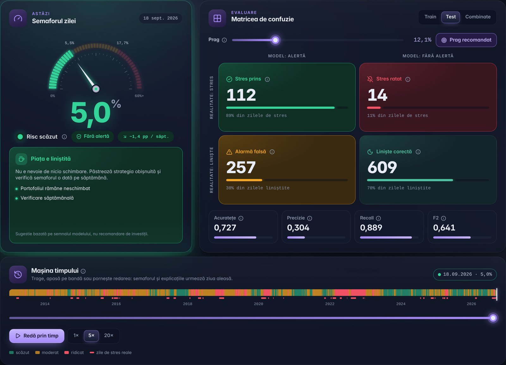
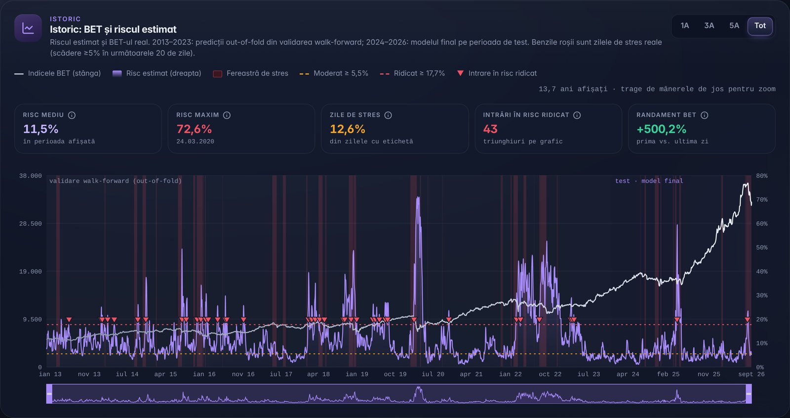
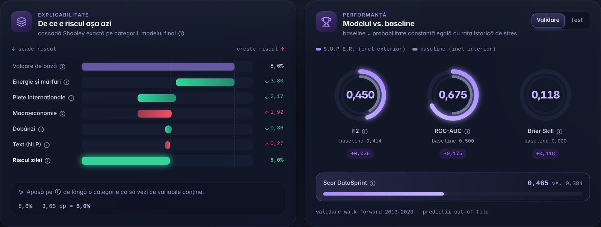
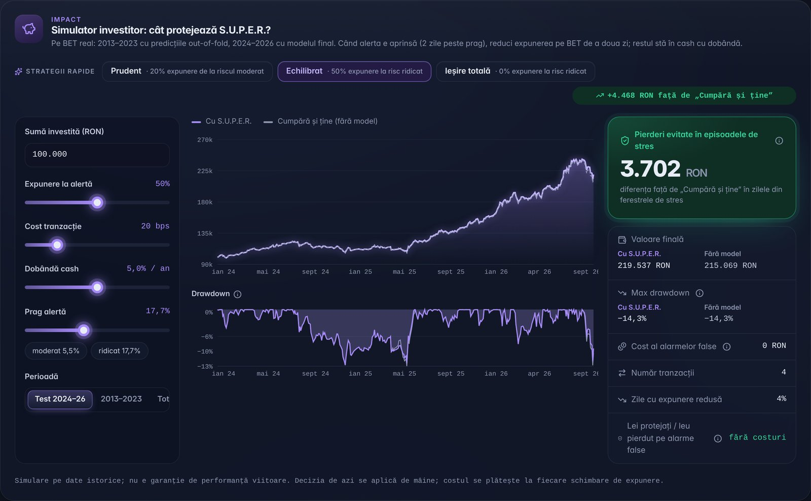
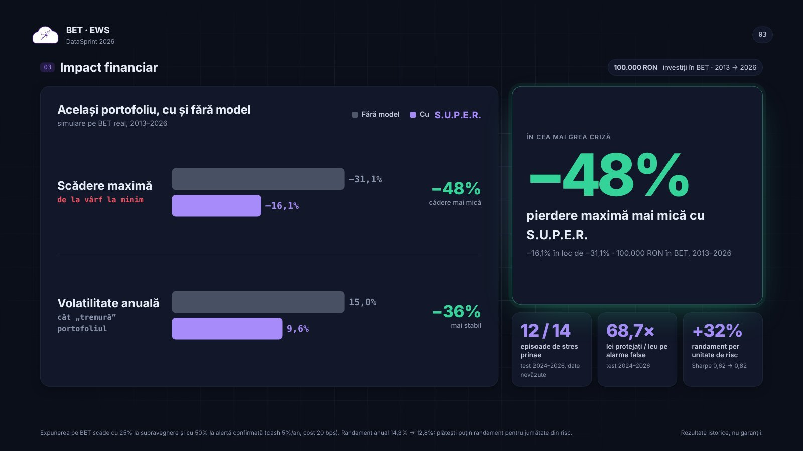

# S.U.P.E.R. BET: early warning system for the Bucharest Stock Exchange

🏆 **Winner of the "Risk Radar" special award** at the DataSprint 2026 datathon (ASE × KPMG), 4–6 November 2026 · team *CH4MPIONS*

S.U.P.E.R. estimates, every day, the probability that the **BET index falls by at least 5% within the next 20 trading days**.
It turns that probability into risk levels and confirmed alerts, and explains what drives the risk.
The project has three parts: a machine learning model, an interactive dashboard and the pitch presentation.

**[Live dashboard](https://paulc02.github.io/datasprint-2026-bet-ews/)** · **[Presentation](https://paulc02.github.io/datasprint-2026-bet-ews/presentation/)** · **[Notebook](notebooks/model_final.ipynb)**



## My role

I worked mainly on the **modeling** (the full notebook: data alignment, feature engineering, validation, models, explainability)
and on the **dashboard** (React + TypeScript app built on the model's outputs).

## Results

| | |
|---|---|
| Kaggle score (official metric) | **0.636** |
| Walk-forward validation score, 2013–2023 | **0.465** vs. 0.384 for a constant baseline |
| ROC-AUC (validation) | 0.676 |
| Stress episodes 2013–2023 with an alert in the 30 days before onset | 15 / 15, median lead time 29 days |

Official metric: `0.625 · F2 + 0.25 · ROC-AUC + 0.125 · Brier Skill Score`. It weighs recall heavily, because a missed crash costs more than a false alarm.

**Portfolio simulation** (100,000 RON in BET, 2013–2026; exposure reduced by 25% under watch and 50% under confirmed alert):
maximum drawdown −31.1% → **−16.1%**, annual volatility 15.0% → **9.6%**, Sharpe ratio 0.62 → **0.82**.
These are historical simulations, not guarantees.

## How the model works

1. **No look-ahead.** Monthly and quarterly macro series become visible only on their publication date, not on their reference date.
   Text documents become visible the day after they are published.
2. **Features (130 built, 25 kept).** Markets (European and US indices, VIX/VSTOXX, RON exchange rates, ROBOR, oil, gold),
   macro data (inflation, unemployment, GDP, trade), geopolitical risk (GPR, GDELT) and NLP signals from central bank and institutional publications
   (bilingual EN/RO lexicons). Variables are kept only if their effect has the same sign in every sub-period. Of any pair that is highly correlated, only one is kept.
3. **Walk-forward validation with a 35-day gap.** For every year from 2010 to 2023 the models train only on earlier data.
   The gap matters because the target windows overlap and the target is strongly autocorrelated.
4. **Three base models + stacking.** Logistic regression, LightGBM (tuned with Optuna) and a discrete-time **survival (hazard) model**
   that estimates on which of the next 20 days the drop is likely to happen. A stacking meta-model combines them and had the best validation score.
5. **Decision layer.** An alert starts after 2 consecutive days above the threshold and stops after 3 days below it, to avoid flickering.
   The thresholds are chosen on validation data: the alert threshold maximises F2, and the "high risk" threshold is where the historical stress rate is at least twice the average.
6. **Explainability.** Logistic coefficients, permutation importance, SHAP (beeswarm, waterfall, dependence), LIME, and
   **exact Shapley values per category** (markets, energy, macro, rates, text…), which split each day's risk across the categories.

> The notebook also contains a Kaggle-specific post-processing step (section 11) that reshapes probabilities for the leaderboard metric.
> The dashboard and all the explanations use the model's **raw probabilities**, not the leaderboard-tuned ones.



## Dashboard

Static React app (TypeScript, Tailwind, Recharts, Radix UI) with no backend. All data comes from the model export.

- **Daily signal**: today's risk gauge, risk level and a plain-language recommendation
- **Confusion matrix** with an adjustable threshold, on train / test / combined data
- **Time machine**: replay any day since 2013
- **History** of BET vs. estimated risk, with the real stress windows highlighted
- **Why the risk is what it is today**: Shapley waterfall by category
- **Proof of alerts**: every stress episode in the test period, with lead time and maximum drop
- **Investor simulator**: the same portfolio with and without the model, with adjustable exposure, costs and thresholds

| Explainability and performance | Investor simulator |
|---|---|
|  |  |

## Presentation

The pitch deck is a single HTML file ([`presentation/index.html`](presentation/index.html)). Use the arrow keys or the space bar to move between slides.



## Repository structure

```
├── notebooks/
│   └── model_final.ipynb      # full pipeline: data → features → validation → models → explainability
├── dashboard/                 # React + TypeScript dashboard (see dashboard/README.md)
│   ├── src/                   # components, analytics, model data (src/data/realData.json)
│   └── scripts/               # export from the notebook → dashboard data
├── presentation/
│   └── index.html             # pitch deck
├── docs/img/                  # screenshots
├── .github/workflows/         # automatic deploy to GitHub Pages
└── requirements.txt
```

## Running it

**Notebook**

```bash
pip install -r requirements.txt
jupyter notebook notebooks/model_final.ipynb
```

The competition data was provided by the organisers on Kaggle and is not redistributed here.
Put the files in a `data/` folder (or run the notebook on Kaggle). The notebook searches `data/`, `.` and `/kaggle/input` automatically.

**Dashboard** (Node.js 18+)

```bash
cd dashboard
npm ci
npm run dev        # http://localhost:5173
```

## Tech stack

Python · pandas · scikit-learn · LightGBM · Optuna · SHAP · LIME · statsmodels · matplotlib/seaborn
React · TypeScript · Vite · Tailwind CSS · Recharts · Radix UI

---

*Code comments and notebook text are in Romanian.*
